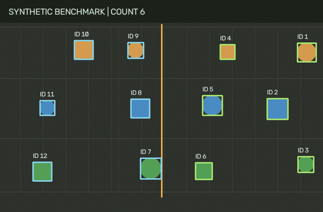

# Conveyor Part Tracking and Counting Project Report

## Purpose and provenance

An independent industrial-vision demonstrator for a fixed camera viewing coloured, separated parts on a conveyor. The implementation was prepared in October 2026 for a mechatronics and robotics portfolio.

## Engineering approach

HSV saturation/value segmentation separates coloured parts from a neutral belt. Morphological opening removes small noise. Connected components provide bounding boxes and centroids. A distance-gated, one-to-one greedy association links detections to tracks. A line with a hysteresis band counts confirmed tracks moving left to right once per track. Short detection dropouts preserve identity; stale tracks expire.

## Reproduction

Install the pinned development requirements in a clean Python 3.12 environment. Run `python -m pytest -q`, then `python app.py --demo`. Configuration, fixed seeds and ground-truth generation are visible in `app.py`. Actual outputs are recorded in `outputs/results.json`.

## Evaluation

6 tests passed. Five deterministic synthetic clips contained 60 expected crossings in total; the pipeline counted 60. Mean absolute count error was 0 per clip. These clips use separated lanes, colour contrast, lighting variation and sensor noise; they do not establish performance under touching parts or occlusion.

## Interpretation and limitations

The detector assumes coloured parts against a neutral background. Greedy centroid matching can exchange identities during close interactions, occlusion or large jumps. Merged components and tracks lost near the line can cause count errors. Camera vibration, reflections and unrelated saturated regions may create false detections. Processing times in results.json are environment-specific and exclude decoding/rendering. The current evidence supports this limited demonstration. Independent tests on new real inputs are needed before presenting broader performance claims.

## Next experiment

Record a real conveyor or tabletop clip with manual crossing annotations. Include occlusions and similar-coloured parts. Compare this classical baseline with a learned detector and a motion-model tracker.

## How to explain this in an interview

Explain the input assumptions first, then walk through the pipeline and a failure case. Show the test and generated result that supports each numerical claim. Be able to change one threshold, rerun the experiment and explain how it affects the result.

## References

- https://docs.opencv.org/4.x/d3/dc0/group__imgproc__shape.html
- https://docs.opencv.org/4.x/df/d9d/tutorial_py_colorspaces.html
